# Ranu.js Documentation Hub

Welcome to the official documentation for **Ranu.js**, the modern full-stack TypeScript framework built on W3C Web Standards, React 19 Streaming Server-Side Rendering (SSR), compile-time isolation, and a pluggable deployment adapter architecture.

---

## 🗺️ Documentation Architecture

```mermaid
flowchart TD
    Hub[docs/README.md - Documentation Hub]

    Hub --> GettingStarted[Getting Started]
    Hub --> Guides[Developer Guides]
    Hub --> Reference[API & CLI Reference]
    Hub --> Ecosystem[Ecosystem & Plugins]
    Hub --> Security[Security & Guardrails]

    GettingStarted --> GS_Install[Installation & System Setup]
    GettingStarted --> GS_Structure[Project Topology & Conventions]
    GettingStarted --> GS_App[First Full-Stack Application]

    Guides --> Guide_Deploy[Deployment & Operations]
    Guides --> Guide_Routing[File-System Routing & Layouts]
    Guides --> Guide_Data[API Routes & Form Actions]
    Guides --> Guide_DB[Databases & Connection Pools]
    Guides --> Guide_Auth[Sessions, OAuth & CSRF]
    Guides --> Guide_Style[Tailwind & CSS Modules]
    Guides --> Guide_AI[Universal AI Engineering]

    Reference --> Ref_CLI[CLI Commands]
    Reference --> Ref_Config[ranu.config.ts Schema]
    Reference --> Ref_React[React Integration Hooks]
    Reference --> Ref_Runtime[Server & Runtime API]

    Ecosystem --> Eco_Plugins[Plugin Specification v1]
    Ecosystem --> Eco_Storage[Cloud Object Storage]
    Ecosystem --> Eco_Providers[Verified Infrastructure Partners]

    Security --> Sec_Boundaries[Compiler Boundaries & server-only]
    Security --> Sec_Policy[Vulnerability Disclosure Policy]
```

---

## ⚡ Fast-Track Navigation

| What are you trying to do?            | Recommended Starting Point                                                 | Key Technologies / Concepts                  |
| :------------------------------------ | :------------------------------------------------------------------------- | :------------------------------------------- |
| **Start a brand new project**         | [Getting Started: Installation](./getting-started/02_INSTALLATION.md)      | Node 20+, pnpm, create-ranu                  |
| **Understand the project structure**  | [Project Structure Guide](./getting-started/03_PROJECT_STRUCTURE.md)       | `app/`, `public/`, `ranu.config.ts`          |
| **Build your first full-stack app**   | [Building Your First App](./getting-started/04_FIRST_APP.md)               | React 19 SSR, API Routes, `<Link>`           |
| **Configure pages & nested layouts**  | [Pages & Layouts Guide](./guides/routing/01_PAGES_AND_LAYOUTS.md)          | Root layouts, sub-layouts, active link state |
| **Build REST APIs & form actions**    | [API Routes Guide](./guides/data-fetching/01_API_ROUTES.md)                | W3C `Request`/`Response`, `useActionState`   |
| **Connect a database**                | [PostgreSQL & Connection Pooling](./guides/database/02_POSTGRESQL.md)      | `pg`, Drizzle ORM, Prisma, pool safety       |
| **Deploy to Vercel**                  | [Vercel Deployment Guide](./guides/deployment/04_VERCEL_ADAPTER.md)        | `@ranujs/adapter-vercel`, Build Output v3    |
| **Deploy to Cloudflare Workers**      | [Cloudflare Workers Guide](./guides/deployment/05_CLOUDFLARE_WORKERS.md)   | `workerd`, V8 isolates, Wrangler             |
| **Deploy with Docker**                | [Docker Containerization](./guides/deployment/02_DOCKER_CONTAINER.md)      | Multi-stage Alpine, unprivileged security    |
| **Run as a standalone Node daemon**   | [Node.js Standalone Daemon](./guides/deployment/06_NODE_STANDALONE.md)     | Standalone HTTP/2, Express, Fastify, PM2     |
| **Deploy to Bun or Deno**             | [Bun and Deno Guide](./guides/deployment/07_BUN_AND_DENO.md)               | `Bun.serve()`, `Deno.serve()`, Web Standards |
| **Deploy to Netlify**                 | [Netlify Adapter Guide](./guides/deployment/08_NETLIFY_ADAPTER.md)         | Edge & Functions, cookie preservation        |
| **Build streaming AI applications**   | [Universal AI Engineering](./guides/ai/README.md)                          | W3C `ReadableStream`, tool calling, SSE      |
| **Protect private server secrets**    | [Compiler Boundaries](./security/COMPILER_BOUNDARIES.md)                   | `@ranujs/core/server-only`, secret stripping |

---

## 1. 🚀 Getting Started

Step-by-step guides for onboarding new developers:

- **[Framework Overview & Philosophy](./getting-started/01_OVERVIEW.md)**  
  The Adopt / Avoid / Adapt design philosophy, comparison with traditional frameworks, and core capabilities.
- **[Installation & System Requirements](./getting-started/02_INSTALLATION.md)**  
  Environment prerequisites (Node.js 20+, pnpm/npm/yarn), scaffolding via `create-ranu`, and dependency setup.
- **[Project Structure & Configuration](./getting-started/03_PROJECT_STRUCTURE.md)**  
  Directory topology (`app/`, `public/`, `node_modules/`), configuration file format (`ranu.config.ts`), and TypeScript configuration.
- **[Building Your First Full-Stack Application](./getting-started/04_FIRST_APP.md)**  
  Creating layouts, rendering React 19 pages, building API handlers, and testing client-side transitions.

---

## 2. 📖 Developer Guides

Domain-specific implementation guides for production workloads. See the **[Developer Guides Master Index](./guides/README.md)** for the complete guide directory.

### Deployment & Production Operations

- **[01: Node.js Server Runbook](./guides/deployment/01_NODE_SERVER.md)** — Production server lifecycle, PM2 cluster management, and graceful systemd shutdown.
- **[02: Docker Containerization](./guides/deployment/02_DOCKER_CONTAINER.md)** — Multi-stage Alpine Dockerfile, unprivileged non-root user hardening, and health probes.
- **[03: Edge Platforms Overview](./guides/deployment/03_EDGE_PLATFORMS.md)** — Edge isolation architectures, W3C standards compliance, and adapter model.
- **[04: Vercel Adapter](./guides/deployment/04_VERCEL_ADAPTER.md)** — First-party `@ranujs/adapter-vercel`, Build Output API v3, serverless connection pool defense, and CI/CD pipelines.
- **[05: Cloudflare Workers Adapter](./guides/deployment/05_CLOUDFLARE_WORKERS.md)** — `workerd` V8 isolates, streaming backpressure, `ctx.waitUntil()`, and Wrangler setup.
- **[06: Node.js Standalone Daemon](./guides/deployment/06_NODE_STANDALONE.md)** — Embedding Ranu.js with Express and Fastify, socket backpressure draining, V8 heap tuning, and connection draining.
- **[07: Bun and Deno Runtimes](./guides/deployment/07_BUN_AND_DENO.md)** — High-performance native `Bun.serve()` and `Deno.serve()` streaming with zero transport shims.
- **[08: Netlify Adapter](./guides/deployment/08_NETLIFY_ADAPTER.md)** — Hybrid Edge and Serverless functions, RFC 6265 multi-cookie preservation, and request body cloning guards.

### Application Routing & Layouts

- **[Pages & Nested Layouts](./guides/routing/01_PAGES_AND_LAYOUTS.md)** — Root layout (`app/layout.tsx`) and nested layout composition.
- **[Dynamic & Catch-All Routes](./guides/routing/02_DYNAMIC_ROUTES.md)** — Parameterized segments (`[id]`) and catch-all routes (`[...slug]`).
- **[Zero-Reload Client Navigation](./guides/routing/03_CLIENT_NAVIGATION.md)** — Native `<Link />` prefetching and active link states.
- **[Custom 404 & Error Boundaries](./guides/routing/04_CUSTOM_404_ERRORS.md)** — Custom `app/404.tsx` error boundaries and fallback UI.

### Data Fetching & Server APIs

- **[API Routes & Handlers](./guides/data-fetching/01_API_ROUTES.md)** — REST endpoint handlers using standard W3C `Request` and `Response`.
- **[React 19 Form Actions](./guides/data-fetching/02_FORM_ACTIONS.md)** — Server mutations, `useActionState`, and progressive enhancement.
- **[Streaming Responses & SSE](./guides/data-fetching/03_STREAMING_RESPONSES.md)** — W3C `ReadableStream` pipelines and realtime Server-Sent Events.
- **[HTTP Caching & Headers](./guides/data-fetching/04_CACHING_HEADERS.md)** — `Cache-Control`, `stale-while-revalidate`, and edge CDN caching.

### Authentication & Access Control

- **[Session Cookies](./guides/auth/01_SESSION_COOKIES.md)** — HTTP-only cookie storage, session encryption, and token rotation.
- **[Protected Routes & Middleware](./guides/auth/02_PROTECTED_ROUTES.md)** — Route guarding with `middleware.ts`, path matchers, and redirects.
- **[OAuth 2.0 Integration](./guides/auth/03_OAUTH_INTEGRATION.md)** — Vendor-neutral Authorization Code Flow with PKCE.
- **[CSRF Protection](./guides/auth/04_CSRF_PROTECTION.md)** — Double-submit cookie pattern, `SameSite` policies, and origin validation.

### Databases & ORMs

- **[Embedded SQLite](./guides/database/01_SQLITE_LOCAL.md)** — WAL mode, embedded persistence, and zero-configuration setups.
- **[Production PostgreSQL](./guides/database/02_POSTGRESQL.md)** — Connection pooling with `pg`, SSL configuration, and transaction safety.
- **[Drizzle ORM](./guides/database/03_DRIZZLE_ORM.md)** — TypeScript schema definition, migrations, and zero-codegen queries.
- **[Prisma Setup](./guides/database/04_PRISMA_SETUP.md)** — Declarative models, development HMR client caching, and server isolation.

### Styling & UI Systems

- **[Tailwind CSS](./guides/styling/01_TAILWIND_CSS.md)** — PostCSS pipeline, layout injection, and instant HMR updates.
- **[CSS Modules](./guides/styling/02_CSS_MODULES.md)** — Component-scoped class names, zero runtime footprint, and composition.
- **[Static Assets & Fonts](./guides/styling/03_ASSETS_AND_FONTS.md)** — `public/` assets, SVG vectors, and self-hosted `@font-face` optimization.

### Universal AI Engineering Series

- **[Universal AI Engineering Series Overview](./guides/ai/README.md)** — 6-part master curriculum for AI engineering:
  - `01_STREAMING_FOUNDATIONS.md` — W3C `ReadableStream` and Server-Sent Events.
  - `02_MODEL_ABSTRACTIONS_AND_ROUTING.md` — Provider-agnostic model dispatch.
  - `03_STRUCTURED_OUTPUTS_AND_TOOLS.md` — Schema validation and tool calling.
  - `04_STATE_AND_VECTOR_RETRIEVAL.md` — Vector embeddings and RAG ingestion.
  - `05_AGENTIC_LOOPS_AND_WORKFLOWS.md` — Autonomous agent loops and state machines.
  - `06_PRODUCTION_HARDENING_AND_GATEWAYS.md` — Rate limiting, PII redaction, and gateways.

---

## 3. 📚 API & CLI Reference

Comprehensive technical API documentation and type signatures:

- **[CLI Reference Manual](./reference/cli/README.md)**  
  Full command-line reference for `ranu dev`, `ranu build`, `ranu start`, and `ranu deploy`, including all environment variables and flags.
- **[Configuration Reference (`ranu.config.ts`)](./reference/config/README.md)**  
  Complete schema for `defineConfig()`, covering `server`, `build`, `deployment`, and plugin configuration options.
- **[React Integration API](./reference/react/README.md)**  
  Client component hooks, `<Link />` component props, router context, and metadata generation helpers.
- **[Server & Runtime API](./reference/runtime/README.md)**  
  Server utilities including `cookies()`, `headers()`, `redirect()`, `notFound()`, and `getRequestContext()`.

---

## 4. 🌐 Ecosystem & Plugins

Extend Ranu.js with verified ecosystem packages and partner integrations:

- **[Ecosystem Hub & Directory](./ecosystem/README.md)**  
  Overview of official and community extensions, adapters, and tools.
- **[Plugin API Specification v1](./ecosystem/plugins/PLUGIN_SPECIFICATION.md)**  
  Formal contract and lifecycle hooks for developing custom Ranu.js compiler and runtime plugins.
- **[Cloud Object Storage](./ecosystem/storage/README.md)**  
  Standardized patterns for S3-compatible, Cloudflare R2, and persistent blob storage.
- **[Verified Providers Directory](./ecosystem/providers/README.md)**  
  Directory of verified infrastructure partners, hosting targets, and certification criteria.

---

## 5. 🛡️ Security & Compiler Boundaries

Security guarantees, boundary enforcement, and vulnerability disclosures:

- **[Compiler Boundaries & Secret Isolation](./security/COMPILER_BOUNDARIES.md)**  
  AST-level private environment variable stripping (`RANU_PUBLIC_*` whitelist), `@ranujs/core/server-only` import guards, and ReDoS defense mechanisms.
- **[Security Policy & SLA](./security/SECURITY_POLICY.md)**  
  Responsible vulnerability disclosure policy, response SLA, and safe harbor guidelines.

---

## 🔒 Framework Invariants

Every Ranu.js application adheres to four fundamental engineering invariants:

1. **Pure W3C Web Standards:** The runtime engine operates exclusively on standard `Request`, `Response`, `Headers`, and `ReadableStream` instances.
2. **Zero Vendor Coupling:** Application code and route handlers never import cloud provider SDKs (`@vercel/*`, `@cloudflare/*`).
3. **The Zero Re-Compilation Invariant:** Production builds are completely deterministic. Adapters package pre-compiled outputs without re-parsing or modifying application source code.
4. **Physical Secret Isolation:** Client bundles cannot contain server secrets; referencing non-public environment variables triggers a fatal build abort.
