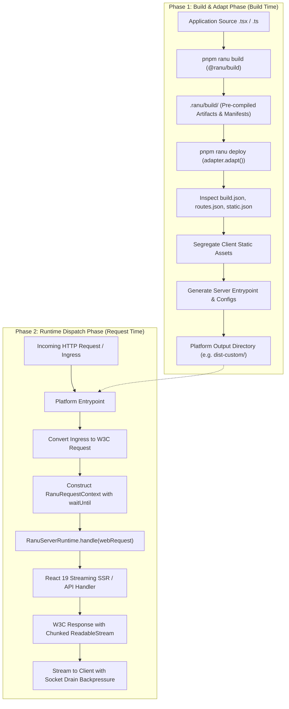

# Authoring Custom Deployment Adapters

This guide provides a comprehensive manual for building custom deployment adapters for **Ranu.js**.

Whether you are targeting an enterprise Kubernetes cluster, internal serverless infrastructure, bare-metal edge nodes, an alternative cloud provider (such as AWS Lambda, Google Cloud Run, or Fastly Compute), or a proprietary container runtime, Ranu.js provides a clean, standardized contract for platform adaptation.

---

## 1. Architectural Philosophy & The Two-Phase Lifecycle

Ranu.js strictly separates **application compilation** from **platform deployment packaging** through the `RanuDeploymentAdapter` interface exported from `@ranu/core`.

### The Zero Re-Compilation Invariant

Traditional frameworks often intertwine bundling with deployment, re-compiling user application code inside provider-specific deployment plugins. This introduces major operational hazards:

- **Build Drift:** Inconsistent bundle outputs between local staging and cloud targets.
- **Vendor Runtime Coupling:** Proprietary vendor SDKs leaking into framework kernels and route code.
- **Secret Leaks:** Accidental bundling of server secrets into browser assets during opaque compilation passes.

To eliminate these vulnerabilities, Ranu.js mandates the **Zero Re-Compilation Invariant**:

> **The Zero Re-Compilation Invariant:**  
> A deployment adapter **MUST NEVER** re-compile, re-bundle, or re-parse user application source code (`.tsx`, `.ts`, `.jsx`, `.js`). Adapters operate strictly as downstream manifest consumers and artifact packagers, transforming pre-compiled artifacts in `.ranu/build/` into target platform formats.

### The Two-Phase Execution Model

The adapter lifecycle is cleanly divided into two phases:



1. **Phase 1: Build & Adapt (`adapt(context)`)**  
   Invoked by `@ranu/cli` via `pnpm ranu deploy`. The adapter inspects `.ranu/build/`, reads JSON manifests, segregates static assets for CDN distribution, and generates a minimal platform runtime entrypoint script without touching user source code.
2. **Phase 2: Runtime Dispatch (`RanuServerRuntime.handle()`)**  
   Invoked on every incoming HTTP request on the hosting target. The platform entrypoint converts incoming network events to a standard W3C `Request`, dispatches through `RanuServerRuntime.handle()`, and streams the resulting W3C `Response` back to the transport socket with active backpressure control.

---

## 2. Core TypeScript Interface Contracts

All adapters implement the formal contracts exported by `@ranu/core`.

### 2.1 `RanuDeploymentAdapter`

The universal adapter interface:

```typescript
import type { DeploymentCapabilities } from './capabilities.js';
import type { DeploymentAdapterContext } from './context.js';
import type { DeploymentResult } from './result.js';

export interface RanuDeploymentAdapter {
  /** Unique identifier of the adapter (e.g. 'enterprise-cloud', 'custom-docker') */
  readonly name: string;

  /** API specification version (current specification: 1) */
  readonly apiVersion: number;

  /** Declared capabilities and operational guarantees of the hosting target */
  readonly capabilities: DeploymentCapabilities;

  /**
   * Phase 1 build hook.
   * Transforms .ranu/build/ artifacts into target platform structures.
   * Must NEVER re-compile application source files.
   */
  adapt(context: DeploymentAdapterContext): Promise<DeploymentResult>;
}
```

### 2.2 `DeploymentCapabilities`

Declares platform execution characteristics and constraints:

```typescript
export interface DeploymentCapabilities {
  /** Target execution environment */
  readonly runtime: 'node' | 'edge' | 'workerd' | 'bun' | 'deno' | 'static';

  /** Indicates support for React 19 streaming server-side rendering */
  readonly ssr: boolean;

  /** Indicates support for standalone API route handlers */
  readonly apiRoutes: boolean;

  /** Indicates support for middleware pipeline execution prior to route dispatch */
  readonly middleware: boolean;

  /** Indicates support for chunked HTTP streaming responses */
  readonly streaming: boolean;

  /** Indicates support for static file serving directly from edge/CDN */
  readonly staticFiles: boolean;

  /** Indicates support for dynamic runtime environment variables */
  readonly runtimeEnvironment: boolean;

  /** Target filesystem access permissions */
  readonly writableFilesystem: 'none' | 'temporary' | 'persistent';

  /** True for persistent long-running daemons; false for ephemeral serverless invocations */
  readonly longLivedProcess: boolean;

  /** Extension flag: hosting target supports background execution extension via waitUntil() */
  readonly supportsWaitUntil?: boolean;

  /** Extension flag: recommended maximum database connection pool size per compute instance */
  readonly maxDatabaseConnections?: number;
}
```

### 2.3 `DeploymentAdapterContext`

Supplied to `adapt()` by the CLI:

```typescript
export interface DeploymentAdapterContext {
  /** Absolute path to the user application project root directory */
  readonly projectRoot: string;

  /** Absolute path to .ranu/build containing compiled artifacts (default: '<projectRoot>/.ranu/build') */
  readonly buildDir?: string | undefined;

  /** Target output directory for platform-specific build output */
  readonly outputDir?: string | undefined;

  /** Standardized logging facility */
  readonly logger?: {
    info(message: string): void;
    warn(message: string): void;
    error(message: string): void;
    debug(message: string): void;
  };
}
```

### 2.4 `DeploymentResult`

Returned by `adapt()` upon successful transformation:

```typescript
export interface DeploymentResult {
  /** Indicates whether adaptation completed successfully */
  readonly success: boolean;

  /** Platform target identifier (e.g. 'custom-runtime', 'enterprise-cloud') */
  readonly target: string;

  /** Absolute path to the directory containing deployable platform artifacts */
  readonly outputDirectory: string;

  /** List of generated and emitted file paths */
  readonly files?: readonly string[] | undefined;

  /** Non-fatal warnings encountered during adaptation */
  readonly warnings?: readonly string[] | undefined;

  /** Structured diagnostics */
  readonly diagnostics?: readonly any[] | undefined;
}
```

### 2.5 `RanuRequestContext`

Supplied to the runtime engine on every request:

```typescript
export interface RanuRequestContext {
  /** Unique request correlation ID for tracing and logging */
  readonly requestId: string;

  /** Standard W3C Request instance representing the incoming HTTP request */
  readonly request: Request;

  /** Parsed URL object of the current request */
  readonly url: URL;

  /** Extracted dynamic and catch-all route parameters */
  readonly params: Record<string, string | string[]>;

  /** Request-scoped storage for middleware and route data propagation */
  readonly locals: Map<string, unknown>;

  /** Abort signal triggered on client disconnect or timeout */
  readonly signal: AbortSignal;

  /** Accumulated Set-Cookie header definitions */
  readonly responseCookies: string[];

  /** Internal middleware recursion depth tracker (capped at 5) */
  readonly depth?: number;

  /**
   * Extends the execution lifetime of the request handler beyond response delivery.
   * Required for serverless and edge environments to flush telemetry or background tasks.
   */
  waitUntil?(promise: Promise<unknown>): void;
}
```

---

## 3. Phase 1: Build & Adapt Deep Dive

The `adapt()` hook converts pre-compiled artifacts in `.ranu/build/` into the target hosting structure.

### 3.1 Inspecting the Build Manifest Suite

Before performing file operations, verify that the application has been built and inspect `.ranu/build/build.json`:

```typescript
import fs from 'node:fs/promises';
import path from 'node:path';
import type { BuildDescriptor, RouteManifest, ServerManifest, StaticManifest } from '@ranu/manifests';

// 1. Verify build descriptor
const buildDescriptorPath = path.join(buildDir, 'build.json');
let buildDescriptor: BuildDescriptor;
try {
  const raw = await fs.readFile(buildDescriptorPath, 'utf8');
  buildDescriptor = JSON.parse(raw);
} catch {
  throw new Error(`Production build artifacts not found at "${buildDir}". Run "pnpm ranu build" first.`);
}

// 2. Validate schema and runtime compatibility
if (buildDescriptor.schemaVersion !== 1) {
  throw new Error(`Unsupported build schema version: ${buildDescriptor.schemaVersion}`);
}
```

The manifest suite contains:

| Manifest Path          | Schema Type       | Contents & Adapter Usage                                                                                                                                                      |
| :--------------------- | :---------------- | :---------------------------------------------------------------------------------------------------------------------------------------------------------------------------- |
| `build.json`           | `BuildDescriptor` | Build metadata, framework version, hash identifier, and relative manifest paths.                                                                                              |
| `manifest/routes.json` | `RouteManifest`   | Complete routing table (`page` vs `api`, dynamic parameters `[id]`, catch-alls `[...slug]`, render modes `ssr` vs `ssg`). Used to configure cloud routing rules and rewrites. |
| `manifest/server.json` | `ServerManifest`  | Maps route IDs to compiled server chunk entrypoints in `.ranu/build/server/`. Used to package standalone functions or modular entrypoints.                                    |
| `manifest/static.json` | `StaticManifest`  | Manifest of all pre-rendered HTML files emitted by Static Site Generation (SSG). Used to configure exact path overrides and content-type headers on CDN proxies.              |

### 3.2 Segregating Static Client Assets

Static assets must be segregated so cloud CDNs or reverse proxies can serve them directly without invoking compute:

```
.ranu/build/
├── static/
│   ├── assets/       <-- Hashed client JS/CSS (immutable cache)
│   └── pages/        <-- Pre-rendered SSG HTML (exact route paths)
└── server/           <-- Compiled server bundles (NEVER expose publicly)
```

1. **Hashed Assets (`.ranu/build/static/assets/`):**  
   Copy to the platform's public static directory under `_ranu/assets/`. Configure immutable caching headers:
   ```http
   Cache-Control: public, max-age=31536000, immutable
   ```
2. **Pre-rendered Pages (`.ranu/build/static/pages/`):**  
   Copy to the static root. These files correspond to pre-rendered HTML routes defined in `manifest/static.json`.
3. **Public Root Files (`public/`):**  
   Copy user-defined static assets (e.g. `favicon.ico`, `robots.txt`, images) from the project's `public/` directory into the platform static directory.

### 3.3 Sensitive File Exclusion Filter

When copying static assets to public directories, adapters must enforce an unconditional security exclusion filter:

```typescript
export function isPubliclyExposable(fileName: string): boolean {
  // Reject sensitive configuration files, source maps, and server bundles
  if (fileName.startsWith('.env')) return false;
  if (fileName.startsWith('.git')) return false;
  if (fileName === '.DS_Store') return false;
  if (fileName.endsWith('.map')) return false;
  if (fileName.startsWith('server')) return false;
  return true;
}
```

### 3.4 Generating Platform Entrypoints

Adapters emit a lightweight entrypoint script that imports `@ranu/runtime` (for Web Standard engines) or `@ranu/runtime-node` (for Node.js engines) and binds the incoming transport to the application.

For a Node.js daemon:

```javascript
// dist/server.mjs
import http from 'node:http';
import { createProductionRuntime, createNodeRequestHandler } from '@ranu/runtime-node';

const runtime = await createProductionRuntime({ buildDir: './artifacts' });
const handler = createNodeRequestHandler(runtime, { buildDir: './artifacts' });

const server = http.createServer((req, res) => handler(req, res));
const port = Number(process.env.PORT) || 3000;

server.listen(port, '0.0.0.0', () => {
  console.log(`Server listening on port ${port}`);
});
```

---

## 4. Phase 2: Runtime Dispatch Deep Dive

During Phase 2, the adapter receives live incoming HTTP traffic and mediates between the hosting platform and the Ranu.js runtime engine.

### 4.1 Ingress Normalization to W3C `Request`

The platform ingress must be translated into a standard W3C `Request` instance:

```typescript
import { Readable } from 'node:stream';
import type { IncomingMessage } from 'node:http';

export function toWebRequest(req: IncomingMessage, options: { trustProxy?: boolean } = {}): Request {
  const protocol =
    options.trustProxy && req.headers['x-forwarded-proto']
      ? String(req.headers['x-forwarded-proto']).split(',')[0].trim()
      : 'http';

  const host =
    options.trustProxy && req.headers['x-forwarded-host']
      ? String(req.headers['x-forwarded-host']).split(',')[0].trim()
      : req.headers.host || 'localhost:3000';

  const url = new URL(req.url || '/', `${protocol}://${host}`);

  const headers = new Headers();
  for (const [key, value] of Object.entries(req.headers)) {
    if (value === undefined) continue;
    if (Array.isArray(value)) {
      for (const item of value) headers.append(key, item);
    } else {
      headers.set(key, value);
    }
  }

  const method = req.method || 'GET';
  const hasBody = method !== 'GET' && method !== 'HEAD';
  const body = hasBody ? (Readable.toWeb(req) as ReadableStream<Uint8Array>) : null;

  return new Request(url.toString(), {
    method,
    headers,
    body,
    // @ts-expect-error Node.js duplex streaming requirement
    duplex: hasBody ? 'half' : undefined,
  });
}
```

> [!CAUTION]
> **Request Body Consumption Trap:**  
> If an edge function or middleware reads the incoming request body (e.g. `await request.json()`), the underlying stream is consumed and locked (`request.bodyUsed === true`). Any subsequent dispatch to `RanuServerRuntime.handle()` will fail. If you must inspect the body prior to dispatch, defensively clone the request first: `const cloned = request.clone()`.

### 4.2 Calling `RanuServerRuntime.handle()`

The adapter invokes `runtime.handle(webRequest)`:

```typescript
import { createProductionRuntime } from '@ranu/runtime';

const runtime = await createProductionRuntime({ buildDir: './artifacts' });
const webResponse = await runtime.handle(webRequest);
```

The runtime pipeline executes:

1. **Trailing slash normalization & asset routing**
2. **Middleware execution pipeline** (depth capped at 5 to prevent infinite rewrite loops)
3. **Route matching** (deterministic hierarchy: Static routes > Dynamic `[id]` > Catch-all `[...slug]`)
4. **React 19 Streaming SSR** (`renderToReadableStream`) or API route invocation

### 4.3 Streaming Response & Dual-Stream Backpressure

Ranu.js utilizes **W3C `ReadableStream<Uint8Array>`** for chunked streaming responses. With React 19, initial document shells flush in `<10ms` TTFB, while dynamic suspense boundaries stream out-of-order as asynchronous data resolves.

#### Node.js Socket Backpressure Control

When streaming chunks into `http.ServerResponse`, if the client is on a slow connection, writing faster than the TCP window allows causes kernel buffers to fill. `res.write(chunk)` returns `false`.

The adapter **MUST suspend reading** until the socket emits `'drain'`:

```typescript
import type { ServerResponse } from 'node:http';

export async function writeWebResponse(webResponse: Response, res: ServerResponse, signal: AbortSignal): Promise<void> {
  res.statusCode = webResponse.status;
  res.statusMessage = webResponse.statusText;

  // 1. Serialize headers and handle RFC 6265 multi-cookies
  const setCookies = webResponse.headers.getSetCookie?.() ?? [];
  if (setCookies.length > 0) {
    res.setHeader('Set-Cookie', setCookies);
  }

  webResponse.headers.forEach((val, key) => {
    if (key.toLowerCase() !== 'set-cookie') {
      res.setHeader(key, val);
    }
  });

  // 2. Handle bodyless status codes (RFC 9110)
  const isBodyless = [101, 204, 205, 304].includes(webResponse.status);
  if (isBodyless || !webResponse.body) {
    res.end();
    return;
  }

  // 3. Stream body with backpressure drainage
  const reader = webResponse.body.getReader();

  const cleanupAbort = () => {
    reader.cancel().catch(() => {});
    if (!res.writableEnded && !res.destroyed) {
      res.destroy();
    }
  };

  signal.addEventListener('abort', cleanupAbort, { once: true });

  try {
    while (true) {
      if (res.destroyed || res.writableEnded) break;

      const { done, value } = await reader.read();
      if (done) break;

      if (value) {
        const canContinue = res.write(value);
        if (!canContinue) {
          // Kernel socket buffer saturated: pause reader until socket drains
          await new Promise<void>((resolve) => {
            res.once('drain', resolve);
          });
        }
      }
    }

    if (!res.writableEnded && !res.destroyed) {
      res.end();
    }
  } finally {
    signal.removeEventListener('abort', cleanupAbort);
    reader.releaseLock();
  }
}
```

#### Web Streams Backpressure (Cloudflare & Edge)

On runtimes with native Web Streams (Cloudflare Workers, Bun, Deno), monitor `ReadableStreamDefaultController.desiredSize`. If `desiredSize <= 0`, chunk enqueueing pauses to prevent unbounded isolate memory buffering and avoid Out-of-Memory (OOM) crashes.

### 4.4 Client Disconnection & Abort Signal Forwarding

When a user closes their browser tab or navigates away during an in-flight stream:

1. The transport emits a termination event (`res.on('close')` or `request.signal.aborted`).
2. The adapter aborts `AbortController.abort()`.
3. React 19's streaming renderer halts component tree evaluation immediately, and downstream database queries bound to the signal are cancelled, preventing wasted compute.

### 4.5 RFC 6265 Multi-Cookie Preservation

When multiple cookies are set, intermediate proxies often collapse them into a single comma-separated header, corrupting cookies that include date formats with commas (`Expires=Wed, 21 Oct 2026`).

Always use `Headers.getSetCookie()` to extract discrete cookie strings:

```typescript
const setCookies = response.headers.getSetCookie?.() ?? [];
if (setCookies.length > 0) {
  // Sanitize CRLF injection attacks
  const sanitized = setCookies.map((c) => c.replace(/[\r\n]+/g, ' ').trim()).filter(Boolean);
  res.setHeader('Set-Cookie', sanitized);
}
```

### 4.6 Bodyless HTTP Status Codes

Per RFC 9110, HTTP status codes `1xx` (Informational), `204` (No Content), and `304` (Not Modified)—as well as responses to `HEAD` requests—must never emit a message body. Adapters must immediately close the response with `res.end()` without attempting to stream the body.

### 4.7 Execution Lifetime Extension (`waitUntil`)

In serverless microVMs (AWS Lambda, Vercel) and V8 isolates (Cloudflare Workers), compute is frozen immediately after the response stream completes. Any un-awaited background promises (such as audit logging, telemetry, or cache invalidation) are aborted.

The adapter must bind the platform's lifetime extension hook into `RanuRequestContext.waitUntil`:

```typescript
const context: RanuRequestContext = {
  requestId,
  request: webRequest,
  url,
  params,
  locals: new Map(),
  signal,
  responseCookies: [],
  waitUntil: (promise: Promise<unknown>) => {
    // Forward promise to platform execution context
    platformContext.waitUntil(promise);
  },
};
```

---

## 5. Security Invariants & Defensive Hardening

Adapters perform filesystem operations and configure execution boundaries. Every custom adapter must enforce three foundational security invariants:

### 5.1 Path Containment Defense (`isPathContained`)

To prevent path traversal attacks (e.g. `outputDir: '../../../../etc'`), verify that all output paths remain strictly contained within authorized parent boundaries:

```typescript
import path from 'node:path';

/**
 * Verifies that childPath resides strictly within parentDir to prevent directory traversal.
 */
export function isPathContained(childPath: string, parentDir: string): boolean {
  const rel = path.relative(path.resolve(parentDir), path.resolve(childPath));
  return !rel.startsWith('..') && !path.isAbsolute(rel);
}
```

Enforce this check on both the target output directory and all copied files:

```typescript
if (!isPathContained(outputDir, projectRoot)) {
  throw new Error(`Security Violation: Output directory "${outputDir}" escapes project root "${projectRoot}".`);
}
```

### 5.2 Destination Symlink Traversal Defense (`assertNoDestinationSymlink`)

Malicious packages or compromised dependencies can create symbolic links targeting sensitive host paths. Adapters must inspect every target directory segment and reject writes through symbolic links:

```typescript
import fs from 'node:fs';
import path from 'node:path';

/**
 * Asserts that no segment of the destination path is a symbolic link.
 */
export function assertNoDestinationSymlink(destination: string, authorizedRoot: string): void {
  let current = path.resolve(destination);
  const root = path.resolve(authorizedRoot);

  while (isPathContained(current, root)) {
    const stat = fs.lstatSync(current, { throwIfNoEntry: false });
    if (stat?.isSymbolicLink()) {
      throw new Error(`Security Violation: Refusing to write through symbolic link at "${current}".`);
    }
    if (current === root) break;
    current = path.dirname(current);
  }
}
```

### 5.3 AST Environment Secret Stripping

To guarantee that database credentials, private API keys, and server-side encryption secrets never leak into client bundles, `@ranu/build` enforces an AST boundary:

1. **Client Whitelist:** Only environment variables prefixed with `RANU_PUBLIC_` (or `PUBLIC_`) are included in browser bundles.
2. **Fatal Compiler Abort:** If client code attempts to reference private variables (e.g. `process.env.DATABASE_URL` or `process.env.SECRET_KEY`), `@ranu/build` triggers a fatal compile error (`RANU_BUILD_PRIVATE_ENV_CLIENT`).
3. **Server Secret Ingestion:** Server secrets must only be accessed inside server route handlers (`app/api/**/route.ts`), server components, or the adapter runtime entrypoint.

---

## 6. End-to-End Reference Implementation

Here is a complete, runnable custom deployment adapter implementation for an **Enterprise Cloud Container Runtime**:

```typescript
// adapters/enterprise-cloud/index.ts
import fs from 'node:fs/promises';
import path from 'node:path';
import type {
  RanuDeploymentAdapter,
  DeploymentCapabilities,
  DeploymentAdapterContext,
  DeploymentResult,
} from '@ranu/core';
import type { BuildDescriptor } from '@ranu/manifests';

export interface EnterpriseCloudAdapterOptions {
  /** Output directory for packaged deployment artifacts (default: 'dist-enterprise') */
  outputDir?: string;
  /** Port for the production server listener (default: 8080) */
  port?: number;
  /** Maximum database connection pool size per container instance */
  maxDatabaseConnections?: number;
}

export function isPathContained(childPath: string, parentDir: string): boolean {
  const rel = path.relative(path.resolve(parentDir), path.resolve(childPath));
  return !rel.startsWith('..') && !path.isAbsolute(rel);
}

export function enterpriseCloudAdapter(options: EnterpriseCloudAdapterOptions = {}): RanuDeploymentAdapter {
  return {
    name: 'enterprise-cloud',
    apiVersion: 1,
    capabilities: {
      runtime: 'node',
      ssr: true,
      apiRoutes: true,
      middleware: true,
      streaming: true,
      staticFiles: true,
      runtimeEnvironment: true,
      writableFilesystem: 'temporary',
      longLivedProcess: true,
      supportsWaitUntil: true,
      maxDatabaseConnections: options.maxDatabaseConnections ?? 15,
    },

    async adapt(ctx: DeploymentAdapterContext): Promise<DeploymentResult> {
      const projectRoot = path.resolve(ctx.projectRoot);
      const buildDir = path.resolve(ctx.buildDir ?? path.join(projectRoot, '.ranu', 'build'));
      const outputDir = path.resolve(ctx.outputDir ?? options.outputDir ?? path.join(projectRoot, 'dist-enterprise'));

      // 1. Security Check: Path containment
      if (!isPathContained(outputDir, projectRoot)) {
        throw new Error(`Security Violation: Target directory "${outputDir}" must reside within project root.`);
      }

      // 2. Validate production build artifacts exist
      const descriptorPath = path.join(buildDir, 'build.json');
      let descriptor: BuildDescriptor;
      try {
        const content = await fs.readFile(descriptorPath, 'utf8');
        descriptor = JSON.parse(content);
      } catch {
        throw new Error(`Production build not found at "${buildDir}". Execute "pnpm ranu build" first.`);
      }

      if (descriptor.runtime !== 'node') {
        throw new Error(`Adapter "enterprise-cloud" requires runtime "node", received "${descriptor.runtime}".`);
      }

      // 3. Prepare clean output directory
      await fs.rm(outputDir, { recursive: true, force: true });
      await fs.mkdir(outputDir, { recursive: true });

      const staticDest = path.join(outputDir, 'public');
      const artifactsDest = path.join(outputDir, 'artifacts');
      await fs.mkdir(staticDest, { recursive: true });
      await fs.mkdir(artifactsDest, { recursive: true });

      // 4. Segregate static client assets
      const staticSrc = path.join(buildDir, 'static');
      try {
        await fs.cp(staticSrc, staticDest, {
          recursive: true,
          filter: (src) => {
            const base = path.basename(src);
            return !base.startsWith('.env') && !base.endsWith('.map') && base !== '.git';
          },
        });
      } catch {
        // static directory optional for pure API projects
      }

      // Also copy user public/ directory if present
      const userPublicDir = path.join(projectRoot, 'public');
      try {
        await fs.cp(userPublicDir, staticDest, { recursive: true });
      } catch {
        // public folder optional
      }

      // 5. Copy pre-compiled server artifacts without re-compilation
      await fs.cp(buildDir, artifactsDest, { recursive: true });

      // 6. Generate production server entrypoint script
      const serverPort = options.port ?? 8080;
      const entrypointContent = `// Enterprise Production Server Entrypoint
import http from 'node:http';
import path from 'node:path';
import { fileURLToPath } from 'node:url';
import { createProductionRuntime, createNodeRequestHandler } from '@ranu/runtime-node';

const __dirname = path.dirname(fileURLToPath(import.meta.url));
const artifactsDir = path.join(__dirname, 'artifacts');

const runtime = await createProductionRuntime({ buildDir: artifactsDir });
const handler = createNodeRequestHandler(runtime, {
  buildDir: artifactsDir,
  trustProxy: true,
});

const server = http.createServer((req, res) => handler(req, res));
const port = Number(process.env.PORT) || ${serverPort};

server.listen(port, '0.0.0.0', () => {
  console.log(\`Enterprise Cloud server listening on port \${port}\`);
});

// Bounded graceful shutdown
const shutdown = () => {
  console.log('Received SIGTERM, draining connections...');
  server.close(() => {
    process.exit(0);
  });
  setTimeout(() => {
    console.error('Shutdown timeout reached, forceful exit.');
    process.exit(1);
  }, 5000).unref();
};

process.on('SIGTERM', shutdown);
process.on('SIGINT', shutdown);
`;

      await fs.writeFile(path.join(outputDir, 'server.mjs'), entrypointContent, 'utf8');

      // 7. Generate production Dockerfile
      const dockerfileContent = `# Enterprise Container Runner
FROM node:22-alpine AS runner
WORKDIR /app
ENV NODE_ENV=production
COPY artifacts/ ./artifacts/
COPY public/ ./public/
COPY server.mjs ./
EXPOSE ${serverPort}
CMD ["node", "server.mjs"]
`;

      await fs.writeFile(path.join(outputDir, 'Dockerfile'), dockerfileContent, 'utf8');

      return {
        success: true,
        target: 'enterprise-cloud',
        outputDirectory: outputDir,
        files: ['server.mjs', 'Dockerfile', 'public/', 'artifacts/'],
      };
    },
  };
}

export default enterpriseCloudAdapter;
```

### Registering the Custom Adapter in `ranu.config.ts`

Import and register the adapter in your project configuration:

```typescript
// ranu.config.ts
import { defineConfig } from '@ranujs/core/config';
import enterpriseCloudAdapter from './adapters/enterprise-cloud/index.js';

export default defineConfig({
  deployment: {
    adapter: enterpriseCloudAdapter({
      port: 8080,
      outputDir: 'dist-enterprise',
      maxDatabaseConnections: 20,
    }),
  },
});
```

Execute the deployment transformation:

```bash
pnpm ranu build
pnpm ranu deploy
```

---

## 7. Testing & Verification Methodology

Before publishing or deploying a custom adapter, verify adherence to all framework requirements:

### 7.1 Automated Verification Test Suite

Create a test file verifying the adapter contract and behavior using Vitest or Node's test runner:

```typescript
// test/enterprise-adapter.test.ts
import { test, expect } from 'vitest';
import path from 'node:path';
import fs from 'node:fs/promises';
import { enterpriseCloudAdapter, isPathContained } from '../adapters/enterprise-cloud/index.js';

test('declares valid capabilities', () => {
  const adapter = enterpriseCloudAdapter();
  expect(adapter.name).toBe('enterprise-cloud');
  expect(adapter.apiVersion).toBe(1);
  expect(adapter.capabilities.ssr).toBe(true);
  expect(adapter.capabilities.streaming).toBe(true);
  expect(adapter.capabilities.longLivedProcess).toBe(true);
});

test('enforces path containment security check', () => {
  expect(isPathContained('/app/dist', '/app')).toBe(true);
  expect(isPathContained('/etc/passwd', '/app')).toBe(false);
  expect(isPathContained('/app/../etc', '/app')).toBe(false);
});

test('fails cleanly when build artifacts are missing', async () => {
  const adapter = enterpriseCloudAdapter();
  await expect(
    adapter.adapt({
      projectRoot: process.cwd(),
      buildDir: path.join(process.cwd(), '.nonexistent-build'),
    }),
  ).rejects.toThrow(/Production build not found/);
});
```

### 7.2 Invariant Verification Checklist

| Invariant / Check            | Expected Behavior                                                                              |
| :--------------------------- | :--------------------------------------------------------------------------------------------- |
| **Zero Re-Compilation**      | Adapter does not invoke `esbuild`, `tsc`, or compilers on user `.tsx`/`.ts` application files. |
| **Manifest Ingestion**       | Ingests `.ranu/build/build.json`, `manifest/routes.json`, and `manifest/static.json` cleanly.  |
| **Path Containment**         | Rejects output directories escaping the project root; halts on directory symlinks.             |
| **Sensitive File Isolation** | Excludes `.env`, `.git`, `.DS_Store`, source maps, and server chunks from public folders.      |
| **Backpressure Drainage**    | Awaits the socket `'drain'` event when `res.write()` returns `false` during streaming.         |
| **Abort Forwarding**         | Cancels stream reader and destroys socket immediately when `signal.aborted` triggers.          |
| **Multi-Cookie Headers**     | Uses `response.headers.getSetCookie()` to preserve discrete `Set-Cookie` header strings.       |
| **Bodyless Responses**       | Calls `res.end()` without body for `1xx`, `204`, `304`, and `HEAD` requests.                   |

---

## 8. Cross-References & Further Reading

- **[Deployment Adapter Contract Specification](../../architecture/03_ADAPTER_CONTRACT.md)** — Architectural specification and formal TypeScript contracts.
- **[Compiler Boundaries & Secret Isolation](../../security/COMPILER_BOUNDARIES.md)** — AST-level private environment variable stripping and `server-only` guards.
- **[Node.js Standalone Daemon Guide](../deployment/06_NODE_STANDALONE.md)** — In-depth guide on `@ranu/runtime-node` socket draining and daemon lifecycles.
- **[Cloudflare Workers Guide](../deployment/05_CLOUDFLARE_WORKERS.md)** — Edge V8 isolate adapter pattern with `ctx.waitUntil()` and Web Streams.
- **[Vercel Adapter Guide](../deployment/04_VERCEL_ADAPTER.md)** — First-party Build Output API v3 adapter implementation.
- **[Bun and Deno Runtimes](../deployment/07_BUN_AND_DENO.md)** — Direct W3C Request/Response streaming on alternative JavaScript runtimes.
- **[Netlify Adapter Guide](../deployment/08_NETLIFY_ADAPTER.md)** — Edge-to-serverless multi-cookie preservation and body cloning patterns.
- **[Configuration Reference Manual](../../reference/config/README.md)** — Complete `ranu.config.ts` deployment options.
